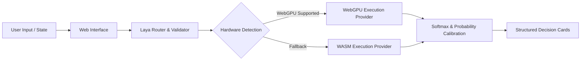

# Architecture & System Design: Laya WebGPU Studio

## 1. Overview
Laya WebGPU Studio is a high-performance, client-side web application that runs Laya's non-autoregressive "System 1" decision engine directly within the user's browser using WebGPU and ONNX Runtime Web.

## 2. Core Components
- **`src/schema.js`**: Validates input states and Laya typed question specifications (`choice`, `score`, `noul`).
- **`src/math.js`**: Implements numerically stable softmax, top-label selection, expected continuous score calculations, and calibrated answer confidence.
- **`src/pipeline.js`**: Handles execution provider resolution (`webgpu` prioritized, `wasm` fallback) and model execution orchestration.
- **`src/main.js`**: Reactive UI controller managing preset switching, WebGPU feature checks, and visual probability rendering.

## 3. Deployment Configuration (Render)
- **Type**: Static Site
- **Build Command**: `npm install && npm run build`
- **Publish Directory**: `dist`
- **Cost**: $0 (Global CDN delivery, client-side compute)
